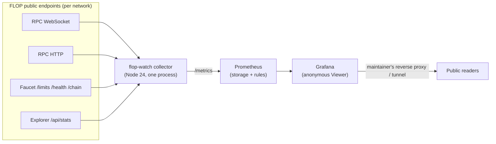

# flop-watch — architecture

Status: proposal, pending approval. Evidence: [research.md](research.md). Scope: [mvp.md](mvp.md).
Every choice below is a `[Decision]` with its reason. Where the 2026-11-25 PoC changed the plan
approved before the research, the change is marked **(PoC-driven)**.

## 1. Overview



- **One collector process** probes every configured network and exposes `/metrics`.
- **Prometheus** scrapes the collector, stores history and evaluates the recording and alert rules.
  Alerts are only displayed; nothing is sent anywhere (no Alertmanager).
- **Grafana** is the only public surface, with read-only anonymous access.
- **The same Compose stack** serves both the public instance and self-hosters. Infrastructure
  details for the public instance (hostname, server, tunnel) are deliberately kept out of this
  repo.

## 2. Technology selection

| Concern | Choice | Reason |
|---|---|---|
| Language | TypeScript `strict`, `erasableSyntaxOnly: true` | The maintainer's standard; type safety for parsers |
| Runtime | Node 24 LTS, running `.ts` directly through type stripping | No build step and no `dist/`. Node v24.11.0 strips types silently (`process.features.typescript === "strip"`), as all PoCs show. Node is the runtime the FLOP packages target. |
| Type check | `tsc --noEmit` | Type checking only, never emitting |
| Modules / package manager | ESM, pnpm | Maintainer's standard |
| Runtime dependency | **`@prometheus-io/client` only** | Metric types, the registry and default process metrics. It is `prom-client` moved to the Prometheus organisation; `prom-client` is deprecated on npm in its favour (2026-08). Same Apache-2.0 licence and transitive dependencies. |
| Dev dependencies | `typescript`, `@types/node`, `@biomejs/biome`, `ws` (+ `@types/ws`) | Type check, lint and format; `ws` serves the fake RPC node in the chain-watcher tests, because Node has a WebSocket client but no server |
| Chain transport | Global `fetch` and `WebSocket`, raw JSON-RPC 2.0 | Verified in the PoC. Uses the legacy `chain_subscribeNewHeads`, `chain_subscribeFinalizedHeads` and `state_subscribeRuntimeVersion`, which were accepted on both networks with no drop in 300 s |
| HTTP server | `node:http` | One route (`/metrics`) plus `/healthz`; no framework needed |
| Tests | `node:test` with recorded fixtures from `poc/results` | No test framework dependency. Timers are injected (`schedule` option) and driven by a manual clock: `node:test`'s timer mocks interfere with the built-in WebSocket client across tests |
| Storage / visualisation | Prometheus + Grafana, official images pinned to exact versions at M3 | Standard, self-hostable, no custom code |
| Deployment | Docker Compose | One file runs both the public instance and self-hosting |
| CI | GitHub Actions | Free for public repos |

## 3. Components

One process with **one independent worker per configured network**. A worker owns its WS
connection, its probe timers and its metric label values. No classes and no patterns beyond plain
functions and closures. [Decision]

| Module | Responsibility |
|---|---|
| `src/main.ts` | Load config, start one worker per network, serve `/metrics`, shut down on SIGTERM |
| `src/config.ts` | Built-in `devnet`/`testnet` profiles, env overrides, validation |
| `src/rpc-http.ts` | JSON-RPC over HTTP; enforces the method allowlist (§11) |
| `src/http.ts` | One HTTP request under the transport rules (timeout, no redirects, User-Agent, Retry-After); the GET client of the faucet and explorer probes |
| `src/chain-watcher.ts` | WS lifecycle: identity calls, subscriptions, health ping, watchdog, backoff, head processing |
| `src/babe.ts` | Pure decoding: SCALE compact, BABE pre-digest (`variant`, `authorityIndex`, `slot`), `BabeApi_configuration` |
| `src/blake2b.ts` | Pure BLAKE2b-256 (RFC 7693) and the header hash. **(PoC-driven)** Checking a parent link needs each block's hash. A header notification does not include it, and `node:crypto` offers only `blake2b512` with a fixed output length. The PoC implementation reproduced the node's block hash on both networks. |
| `src/probes.ts` | Scheduled HTTP probes (RPC HTTP, faucet, explorer): timing, result classification, Retry-After handling |
| `src/parse.ts` | Pure, tolerant parsers for `/limits`, `/health`, `/chain` and `/stats` |
| `src/metrics.ts` | Every metric definition in one place |
| `src/log.ts` | JSON lines to stdout |
| `src/clock.ts` | The injectable `schedule` timer type shared by the watcher and the probes |

## 4. Data collection strategy

Per network:

- **WS.** One persistent connection.
  1. On every (re)connect, call `chain_getBlockHash [0]`, `system_chain`, `state_getRuntimeVersion`
     and `state_call ["BabeApi_configuration","0x"]`.
  2. Then subscribe to new heads, finalized heads and the runtime version.
  3. Every 30 s, send `system_health` over the WS. This doubles as the WS latency probe and as
     keepalive.
- **HTTP RPC.** `chain_getHeader` and `system_health` every 30 s; `chain_getBlockHash [0]` every
  10 min.
- **Faucet.** `/limits`, `/health` **and `/chain`** every 60 s, each in its own loop. **(PoC-driven)**
  The plan had `/chain` every 10 min. The official UI fetches `/chain` on every readiness check, and
  the Testnet `/chain` returned a transient 503 that is enough to disable claims
  ([research.md](research.md) §7). Mirroring the UI requires `/chain` at the same cadence as
  `/limits`.
- **Explorer.** `/api/stats` every 60 s, best-effort, because the API is undocumented.
- **Scheduling.**
  - Each probe's first run is staggered by random jitter of 0–5 s.
  - Runs of the same probe never overlap: a run is skipped if the previous one is still in flight.
  - Timers are per probe, so a slow faucet cannot delay RPC probes.

**Head processing** (per new-head notification):

- Record the receive timestamp and the block number.
- Count `skippedBlocks` (when `n > prev + 1`) and `rewinds` (when `n <= prev`).
- Compute the header hash and decode the BABE pre-digest.
- When `n === prev + 1` **and** `parentHash === hash(prev)`, observe
  `(slot_n − slot_prev) × slotDuration` into the block-interval histogram.
- Finalized-head notifications update the finalized number and its receive timestamp.

In the PoC every interval was exactly 1 s, so the histogram mainly shows when slots are missed.

**Traffic budget** (steady state, per network; pushed WS notifications excluded) [Decision]:

| Calls | Interval | Requests/s |
|---|---|---|
| WS `system_health` | 30 s | 0.033 |
| HTTP `chain_getHeader` + `system_health` | 30 s | 0.067 |
| HTTP `chain_getBlockHash [0]` | 10 min | 0.002 |
| Faucet `/limits` + `/health` + `/chain` | 60 s | 0.050 |
| Explorer `/api/stats` | 60 s | 0.017 |
| **Total** | | **≈ 0.17 (≈ 600 requests/h)**, within the 0.25 requests/s budget |

- **Per host.** That is 0.10 requests/s to the RPC, 0.05 to the faucet and 0.017 to the explorer.
  The Devnet explorer allows 120 requests per minute (`ratelimit-policy: 120;w=60`); we use 1.
- **Reconnects** add 4 calls and 3 subscriptions per connect. The backoff in §5 bounds them.

## 5. Error handling and recovery

- **Timeouts.** HTTP requests, WS requests and the WS connect each time out after 10 s.
- **No retries inside a probe.** A failure is a measurement, and the next cycle is the retry.
- **Rate limiting.** A 429 is recorded as `result="rate_limited"`. If a failed request (a 429 or an
  error status) carries `Retry-After`, that probe's next run is **delayed** until Retry-After has
  passed, capped at 10 min. Probes that share an endpoint share the pause: the RPC HTTP head/health
  and genesis loops, and the three faucet loops. A cycle sends no further request once it has been
  told to wait.
  - **(PoC-driven)** A 503 is **not** recorded as `rate_limited`. The Testnet faucet `/health`
    returns 503 with `Retry-After: 60` as its normal "degraded" answer, which is a valid
    measurement (see the success rules in §6), so its Retry-After pauses nothing.
- **WS reconnect.**
  - Exponential backoff: start at 1 s, double each time, cap at 60 s, with full jitter.
  - The backoff resets after 5 min of stable connection.
  - Every reconnect re-runs the identity calls.
- **Watchdog.** If no new head arrives for 30 s, close with reason `stall_timeout` and reconnect.
  Blocks are produced every second; the PoC's worst Devnet delivery gap was 29 s (60 s run) and
  7.4 s (300 s run). A reconnect may also land on a healthier backend. [Inference]
- **Stale values.**
  - When a fetch or parse fails, remove that source's **value** gauges (`gauge.remove(labels)`), so
    no stale value is shown as current.
  - Keep `*_last_success_timestamp_seconds` and `*_received_timestamp_seconds`, so ages keep
    growing.
  - On WS close, remove the best and finalized block numbers and the WS peers. Keep the
    head-received timestamps.
  - Identity values (`genesis_match`, `chain_info`, `runtime_spec_version`) are kept until the next
    successful check. Removing them during an outage would silence `FlopGenesisMismatch`.
- **Schema tolerance.**
  - If a field is missing or has the wrong type, skip that metric and increment
    `flopwatch_schema_mismatch_total{network,target,field}`. The `field` label comes from a fixed
    allowlist of the fields we read.
  - For the faucet and explorer targets, `field` is the dotted JSON path
    (`faucet.dailyCap.usedFlop`); the allowlists live in `src/parse.ts`. A non-object on the path
    counts as a mismatch of that field. `/health` `dependencies.<name>.ok` and
    `dependencies.indexer.details.lagBlocks` are optional: missing or null, there or anywhere on
    their path, leaves the series absent and counts no mismatch. A missing or non-object
    `dependencies` counts once, as `dependencies`.
  - Unknown enum values map to `other`.
  - The process never crashes on remote data.
- **Runtime upgrades.** Nothing to handle beyond updating the gauge. We decode only two `u64` values
  from one runtime API and the BABE pre-digest, both of which are stable across upgrades, so no
  metadata is needed.
- **Resets.** On a genesis mismatch, set `flopwatch_genesis_match = 0` and keep collecting, so the
  history shows the transition.
- **Isolation.**
  - Each worker catches its own errors, so a failure never affects the other network.
  - Unhandled rejections are logged, never fatal.
  - SIGTERM stops every worker, then the metrics server. Each WebSocket gets up to 5 s to finish
    its close (the close deadline), and the process exits with 0 within 8 s. Docker's default stop
    timeout is 10 s.
- **Close deadline.** A peer that never answers the WebSocket close is abandoned after 5 s, so a
  half-open connection can delay neither a reconnect nor a shutdown.

## 6. Prometheus metric design

**Naming.** Every metric uses the `flopwatch_` prefix.

**Labels** are limited to:

- `network`: the config key.
- `target` ∈ {`rpc_ws`, `rpc_http`, `faucet_limits`, `faucet_health`, `faucet_chain`,
  `explorer_stats`}.
- `transport` ∈ {`ws`, `http`}.
- `result` ∈ {`ok`, `timeout`, `network_error`, `http_error`, `rpc_error`, `invalid_response`,
  `rate_limited`}.
- The small fixed enumerations listed in the table below.

Hashes other than the genesis hash, addresses and error text are **never** labels.

| Group | Category | Metrics |
|---|---|---|
| Probes | measured | `flopwatch_probe_success{network,target}`, `flopwatch_probe_duration_seconds{network,target}` (histogram, buckets 0.05, 0.1, 0.25, 0.5, 1, 2.5, 5, 10), `flopwatch_probe_total{network,target,result}`, `flopwatch_probe_last_success_timestamp_seconds{network,target}` |
| WS | measured | `flopwatch_ws_connected{network}`, `flopwatch_ws_connects_total{network}`, `flopwatch_ws_disconnects_total{network,reason}` (reason ∈ {`close`, `error`, `stall_timeout`}) |
| Chain heads | reported (block numbers), measured (receive timestamps, skips, rewinds) | `flopwatch_chain_best_block_number{network}`, `flopwatch_chain_finalized_block_number{network}`, `flopwatch_chain_best_head_received_timestamp_seconds{network}`, `flopwatch_chain_finalized_head_received_timestamp_seconds{network}`, `flopwatch_ws_head_skipped_blocks_total{network}`, `flopwatch_ws_head_rewinds_total{network}` |
| Block interval | reported by chain | `flopwatch_chain_block_interval_seconds{network}` (histogram from slot deltas under the §4 conditions, buckets 0.5, 1, 1.5, 2, 3, 5, 10, 30, 60), `flopwatch_chain_slot_duration_seconds{network}` |
| Identity | reported | `flopwatch_chain_info{network,chain,spec_name,genesis_hash}` = 1, `flopwatch_runtime_spec_version{network}`, `flopwatch_genesis_match{network,source}` (source ∈ {`rpc_ws`, `rpc_http`, `faucet`}) |
| RPC node | reported | `flopwatch_rpc_node_peers{network,transport}`, `flopwatch_rpc_node_is_syncing{network,transport}`, `flopwatch_rpc_http_best_block_number{network}` |
| Faucet | reported | `flopwatch_faucet_status{network,status}` (state-set: `open`, `low_balance`, `unknown`, `other`), `flopwatch_faucet_stale{network}`, `flopwatch_faucet_limits_as_of_timestamp_seconds{network}`, `flopwatch_faucet_balance_flop`, `flopwatch_faucet_min_balance_flop`, `flopwatch_faucet_daily_cap_limit_flop`, `flopwatch_faucet_daily_cap_used_flop`, `flopwatch_faucet_daily_cap_remaining_flop`, `flopwatch_faucet_pending_grants`, `flopwatch_faucet_sponsor_status{network,lane,status}` (lane ∈ {`miner`, `validator`}; status ∈ {`open`, `automatic_full`, `positions_full`, `unknown`, `other`}), `flopwatch_faucet_health_ready{network}`, `flopwatch_faucet_health_http_status_code{network}`, `flopwatch_faucet_dependency_ok{network,dependency}` (dependency ∈ {`signer`, `indexer`, `ip_classification`, `funding`, `signing`}; `ok` missing or null → series absent), `flopwatch_faucet_indexer_lag_blocks{network}` (when present) |
| Explorer | reported | `flopwatch_explorer_latest_block_number{network}`, `flopwatch_explorer_finalized_lag_blocks{network}`, `flopwatch_explorer_safe_mode{network}` |
| Self | self | `flopwatch_build_info{version}`, `flopwatch_schema_mismatch_total{network,target,field}`, the client library's default process metrics |

Notes:

- **Categories.** Each metric's help text starts with its category. `measured` and `reported` are
  the FLOP signals of §1. `self` describes the collector itself. `derived` never appears in the
  collector, only in rules (§7). Inside a group, single metrics can differ: for example,
  `flopwatch_faucet_health_http_status_code` is measured.
- **Probe success.**
  - Faucet `/health` succeeds when a JSON object comes back with a 2xx or 5xx status: it answers
    503 when degraded. A 3xx, a 429 or any other 4xx is a failure.
    `flopwatch_faucet_health_http_status_code` is set on every response, failures included.
  - Faucet `/chain` also needs a valid `genesisHash`. Without one the probe is `invalid_response`,
    as the official UI's check fails too; the mismatch is counted and `genesis_match` keeps its
    last value.
  - For every other target, success means a 2xx status, parseable JSON (a JSON object for the
    faucet and explorer) and no JSON-RPC error. Missing or retyped fields do not fail a faucet or
    explorer probe; they count as schema mismatches (§5).
  - `rpc_http` success describes the 30 s cycle: `chain_getHeader` and `system_health` both
    succeeded. The 10-min genesis request counts in `probe_total` and `probe_duration_seconds`,
    but not in `probe_success`.
- **`/health` `ready` is per-client.** The faucet scopes it to "this client" (`readinessScope`). It
  was `false` on both networks while `/limits` said `open`. The panel describes it as "readiness for
  the collector's own address", not global readiness. **(PoC-driven)**
- **FLOP amounts** are decimal strings in whole FLOP. They are parsed with `Number()` and fit the
  float64 range observed (≤ 1.2 × 10⁸).
- **Series count.** The expected count is about 400–500 for two networks: about 190 per network,
  plus process metrics. The limit is < 1,000. Check it with `count({__name__=~"flopwatch_.*"})`.

## 7. Derived signals

File: `prometheus/rules/flop-watch.rules.yml`. Everything derived lives **only** in rules. These
are inferences, and each alert's `category` annotation says so.

**Recording rules:**

| Rule | Expression |
|---|---|
| `flopwatch:finality_lag_blocks` | `flopwatch_chain_best_block_number - flopwatch_chain_finalized_block_number` |
| `flopwatch:best_head_age_seconds` | `time() - flopwatch_chain_best_head_received_timestamp_seconds` |
| `flopwatch:finalized_head_age_seconds` | `time() - flopwatch_chain_finalized_head_received_timestamp_seconds` |
| `flopwatch:faucet_limits_age_seconds` | `time() - flopwatch_faucet_limits_as_of_timestamp_seconds` |
| `flopwatch:faucet_claim_ready` | see below |
| `flopwatch:explorer_indexer_lag_blocks` | `flopwatch_chain_best_block_number - flopwatch_explorer_latest_block_number` |

The finality lag can be negative on Devnet, because the WS streams come from mixed backends
([research.md](research.md) §10.2). Panels show it raw, and the alerts only look at the upper
thresholds.

`flopwatch:faucet_claim_ready` mirrors the official Testnet UI's `available()` check
([research.md](research.md) §7):

- `/chain` and `/limits` both fetched successfully;
- the faucet genesis matches;
- `stale == false`;
- `faucet.status == "open"`.

Value gauges disappear on failure, and a plain `and` chain would then return *no series* instead of
`0`. So the rule falls back to `0` explicitly:

```yaml
- record: flopwatch:faucet_claim_ready
  expr: |
    max by (network) (
        (flopwatch_faucet_status{status="open"} == 1)
      and on (network) (flopwatch_faucet_stale == 0)
      and on (network) (flopwatch_genesis_match{source="faucet"} == 1)
      and on (network) (flopwatch_probe_success{target="faucet_limits"} == 1)
      and on (network) (flopwatch_probe_success{target="faucet_chain"} == 1)
    )
    or on (network)
    max by (network) (flopwatch_probe_success{target="faucet_limits"}) * 0
```

The UI's agent-lane checks (`claimPath`, `grantFlop === 10`, `rolling24HourCapFlop === 10`) are
deliberately left out of the rule. They compare against constants in the UI's own release, so a
mismatch there means a UI/backend release skew, not an outage, and it would need extra metrics to
mirror. [Decision]

**Alerts.** Each has a `severity` label and a `category` annotation:

| Alert | Condition | `for` | Severity | Category |
|---|---|---|---|---|
| `FlopRpcWsDown` | `flopwatch_probe_success{target="rpc_ws"} == 0` | 2m | critical | measured |
| `FlopRpcHttpDown` | `flopwatch_probe_success{target="rpc_http"} == 0` | 2m | critical | measured |
| `FlopGenesisMismatch` | `flopwatch_genesis_match == 0` (any source) | 0m | critical | reported |
| `FlopBestHeadStale` | `flopwatch:best_head_age_seconds > 30` | 1m | warning | derived |
| `FlopFinalityLagging` | `flopwatch:finality_lag_blocks > 30` (`FinalityLagWarn`) | 2m | warning | derived |
| `FlopFinalityStalled` | `flopwatch:finality_lag_blocks > 120` (`FinalityFreezeThreshold`) **or** `flopwatch:finalized_head_age_seconds > 120` | 1m | critical | derived |
| `FlopRuntimeUpgraded` | `changes(flopwatch_runtime_spec_version[15m]) > 0` | — | info | reported |
| `FlopFaucetUnreachable` | `flopwatch_probe_success{target="faucet_limits"} == 0` | 5m | warning | measured |
| `FlopFaucetClaimsNotReady` | `flopwatch:faucet_claim_ready == 0` | 5m | warning | derived |
| `FlopFaucetLowBalance` | `flopwatch_faucet_status{status="low_balance"} == 1` | 5m | warning | reported |
| `FlopFaucetLimitsStale` | `flopwatch:faucet_limits_age_seconds > 300` | 5m | warning | derived |
| `FlopExplorerIndexerLagging` | `flopwatch:explorer_indexer_lag_blocks > 120` **or** `flopwatch_probe_success{target="explorer_stats"} == 0` | 5m | warning | derived |
| `FlopWatchDown` | `up{job="flop-watch"} == 0` | 2m | critical | measured |

**Thresholds.**

- 30 and 120 blocks come from the yellowpaper
  ([params](https://raw.githubusercontent.com/flop-labs/yellowpaper/main/params/flop-protocol-params.yaml)).
- All other thresholds and `for` durations are **proposed defaults**, and the rules file labels them
  that way.
- `FlopFaucetLimitsStale` uses 300 s with `for: 5m` because the observed `asOf` age already swings
  between 0.4 and 5.4 min in normal operation (research.md §10.3).

## 8. Grafana

- **Provisioning.** A Prometheus datasource and one dashboard, `flop-watch-overview`, both
  provisioned from files.
- **Network variable.** The `network` variable is single-select, with `testnet` as the default.
  Networks are never mixed in a panel.
- **Rows:**
  1. **Identity:** chain, spec name/version, genesis match per source, runtime-upgrade annotations.
  2. **RPC:** WS and HTTP up; p50/p95 latency from the histogram; peers; WS connects and
     disconnects by reason.
  3. **Blocks:** best and finalized number, finality lag, block interval (heatmap), best and
     finalized head age, skipped and rewound notifications.
  4. **Faucet:** claim readiness (derived, with the UI-mirror explanation); status timeline;
     balance vs. minimum; daily cap; pending grants; `/limits` latency and `asOf` age; sponsor
     lanes; `/health` dependencies.
  5. **Explorer:** indexer lag; probe state.
  6. **Incidents:** state timeline of `ALERTS{alertstate="firing", network="$network"}`.
- **Panel descriptions** state whether the data is **measured**, **reported** or **derived**, and
  name the source call.

## 9. Configuration

- **Built-in profiles** `devnet` and `testnet` hold the endpoints and pinned genesis hashes from
  [research.md](research.md) §2.
- **Environment variables:**

  | Variable | Default | Meaning |
  |---|---|---|
  | `FLOPWATCH_NETWORKS` | `devnet,testnet` | Profiles to run |
  | `FLOPWATCH_<NET>_RPC_WS` | profile | WS RPC URL |
  | `FLOPWATCH_<NET>_RPC_HTTP` | profile | HTTP RPC URL |
  | `FLOPWATCH_<NET>_FAUCET_URL` | profile | Faucet base URL (empty disables) |
  | `FLOPWATCH_<NET>_EXPLORER_API_URL` | profile | Explorer API base URL (empty disables) |
  | `FLOPWATCH_<NET>_EXPECTED_GENESIS` | profile | Pinned genesis hash |
  | `FLOPWATCH_HOST` | `0.0.0.0` | Metrics listen address |
  | `FLOPWATCH_PORT` | `10063` | Metrics port |
  | `FLOPWATCH_LOG_LEVEL` | `info` | `debug`, `info`, `warn`, `error` |

- **Port.** **(PoC-driven)** The planned 9616 is already allocated to the Mailgun Exporter on the
  [Prometheus default port allocations](https://github.com/prometheus/prometheus/wiki/Default-port-allocations)
  page. Port 9615 is the Substrate node's own metrics port. flop-watch uses 10063, the first
  unallocated number after the allocations on 2026-11-25, and is registered there for it
  (2026-11-25, #8).
- **Values.** Every value is trimmed. An empty value means "use the default", except
  `_FAUCET_URL` and `_EXPLORER_API_URL`, where an empty value disables that probe. Keep `.env`
  free of non-collector keys under the `FLOPWATCH_` prefix.
- **Normalisation.** URLs are stored as origin + path without a trailing slash, so probes can
  append paths. The genesis hash is lower-cased.
- **Startup validation** fails fast, in one error that lists every problem, on any of these:
  - an unknown, duplicated or empty network selection;
  - a malformed URL, a scheme that does not fit the field (`ws`/`wss` for `_RPC_WS`, `http`/`https`
    otherwise), or a URL with a query, a fragment or credentials;
  - a genesis that is not 32-byte hex;
  - two networks sharing an expected genesis, or an endpoint (host + path, whatever the scheme);
  - a port outside 1–65535, or an unknown log level;
  - an unknown `FLOPWATCH_*` variable, which catches typos.
- **User-Agent.** Every request sends `User-Agent: flop-watch/<version> (+<repo URL>)`, so FLOP
  operators can identify and contact us.

## 10. Deployment

- **`compose.yaml`** has three services:
  - `flop-watch`: the collector. It is not published; Prometheus scrapes it on the internal
    network.
  - `prometheus`: `--storage.tsdb.retention.time=180d`, `--query.timeout=20s`,
    `--query.max-samples=5000000`. It loads the rules file and is not published.
  - `grafana`: published **only** on `127.0.0.1:3000`. Datasource and dashboard are provisioned
    from files. The admin password comes from `.env`.
- **Volumes.** Named volumes for Prometheus and Grafana data.
- **Collector image.**
  - Base `node:24-alpine`.
  - `pnpm install --prod --frozen-lockfile`.
  - Runs as the non-root `node` user with `CMD ["node", "src/main.ts"]`.
  - `read_only: true` root filesystem; a healthcheck on `/healthz`.
- **Public instance.** The same Compose stack on the maintainer's server. Only Grafana is exposed,
  through the maintainer's reverse proxy or tunnel; that configuration lives outside this repo.
- **Retention.** 180 days covers the roughly 90-day Testnet with headroom. At about 500 series and a
  15 s scrape interval, storage stays in the low hundreds of MB. [Inference]

## 11. Security

- **Read-only by construction.** No keys, no signing, and no POST to the faucet or the gateway.
  Faucet and explorer probes are GET-only, with fixed paths. Redirects are never followed, so no
  request reaches a host that is not configured; a 3xx is recorded as `http_error`. A unit test
  asserts that `src/` contains none of the faucet claim and write paths of hard rule 1.
- **RPC method allowlist.** Enforced in `rpc-http.ts` and `chain-watcher.ts`; anything else throws
  before a request is sent. It allows:
  - `chain_getBlockHash`, `chain_getHeader`, `chain_getFinalizedHead`;
  - `system_health`, `system_chain`, `state_getRuntimeVersion`;
  - `state_call`, only with `BabeApi_configuration`;
  - the subscribe/unsubscribe pairs for new heads, finalized heads and the runtime version.

  A unit test asserts that `author_submitExtrinsic` is rejected.
- **Grafana.**
  - Anonymous access: `GF_AUTH_ANONYMOUS_ENABLED=true`, `GF_AUTH_ANONYMOUS_ORG_ROLE=Viewer`.
  - No sign-up or viewer edits: `GF_USERS_ALLOW_SIGN_UP=false`, `GF_USERS_VIEWERS_CAN_EDIT=false`.
  - External snapshots off: `GF_SNAPSHOTS_EXTERNAL_ENABLED=false`.
  - Analytics and update checks off.
  - The exact settings are confirmed against the pinned version at M3.
- **Residual risk.** Anonymous viewers can send arbitrary PromQL through Grafana's datasource query
  API. This is accepted: all the data is public, and the Prometheus query limits (§10) bound the
  cost.
- **Supply chain.** One runtime dependency, a committed lockfile, images pinned to exact versions,
  and Dependabot or manual updates.
- **No personal data.** Metrics and logs contain no addresses. The faucet signer address in the
  `/limits` and `/health` bodies is never exported, and a failed faucet or explorer request logs
  only the body's `error` string, never the body.

## 12. Trade-offs and rejected alternatives

| Alternative | Reason rejected |
|---|---|
| `@flop-labs/sdk`, `@polkadot/api` or polkadot-api | About 300 MB RSS and 116 packages; metadata initialisation on every connect; the SDK's exact `specVersion` allow-list throws `RUNTIME_INCOMPATIBLE` on upgrades (research.md §5) |
| `chainHead_v1_follow` | Pin/unpin bookkeeping for no gain; the legacy subscriptions work on both networks |
| Bun | No advantage with zero dependencies; Node is what the FLOP packages target, and type stripping removes the build step |
| Python `flop-sdk` | A second runtime for a collector that needs no SDK at all |
| Custom database, API or frontend | Prometheus and Grafana already cover storage, querying and display |
| VictoriaMetrics | Prometheus is the default that Grafana, `promtool` and self-hosters know; about 500 series need no extra efficiency |
| Blackbox / json_exporter or Uptime Kuma | Cannot evaluate JSON-RPC semantics (heads, slots, finality, genesis) without extra components |
| Alertmanager or notifications | User decision: incidents are derived and shown only |
| Zod | Only about 20 fields are read; hand-written tolerant parsers with fixtures suffice |
| `prom-client` | Deprecated on npm in favour of `@prometheus-io/client`, the same code base under the Prometheus organisation (owner-approved switch, #4) |
| Grafana externally shared dashboards | Not file-provisionable; unverified for the pinned version, so confirm at M3 |
| Per-validator authority metrics | Validator seats will grow toward 1,000, which means high cardinality; YAGNI |
